# 🎬 Butaca

**Butaca** es una aplicación web Full-Stack para **decidir qué película ver en grupo**. Reúne a tus amigos, pareja o familia en un grupo, apuntad películas, dejad que **la ruleta** elija y puntuad lo que veáis. Si no sabéis por dónde empezar, **Ratatús** 🐀, nuestra mascota con IA, os recomienda según vuestro ánimo, vuestras notas y las plataformas que tenéis en casa.

> Proyecto del Módulo Full-Stack JS · React + Node.js + MongoDB + TMDB + Google Gemini

| | |
|---|---|
| 🌐 **Web pública (Front-Office)** | **https://butaca-roan.vercel.app** |
| 🛠 **Panel de administración (Back-Office)** | **https://butaca-roan.vercel.app/admin** |
| ⚙️ **API REST** | https://butaca-api.onrender.com · estado: [`/api/health`](https://butaca-api.onrender.com/api/health) |
| 📦 **Repositorio** | https://github.com/alejandrodavidmartino/butaca |

> ℹ️ La API está en el plan gratuito de Render: si nadie la usa durante 15 min se "duerme" y tarda **hasta un minuto** en despertar. La web lo avisa con un mensaje de Ratatús.
>
> 🔑 Las credenciales del usuario administrador para la evaluación se entregan en el documento PDF (no se publican en el repositorio).

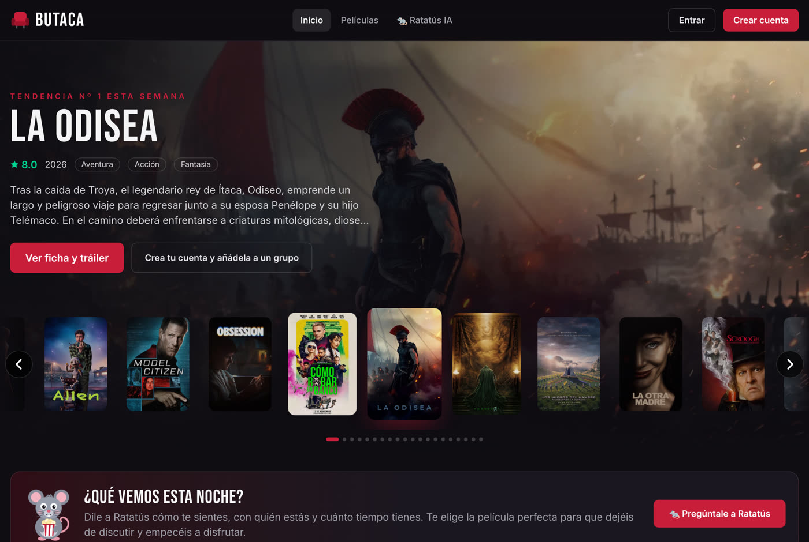

---

## Índice

1. [Idea y público objetivo](#-idea-y-público-objetivo)
2. [Funcionalidades](#-funcionalidades)
3. [Capturas](#-capturas)
4. [Tecnologías](#-tecnologías)
5. [Arquitectura](#-arquitectura)
6. [Estructura del proyecto](#-estructura-del-proyecto)
7. [Instalación en local](#-instalación-en-local)
8. [Variables de entorno](#-variables-de-entorno)
9. [Scripts disponibles](#-scripts-disponibles)
10. [Despliegue](#-despliegue)
11. [API REST](#-api-rest)
12. [Inteligencia artificial: Ratatús](#-inteligencia-artificial-ratatús)
13. [Seguridad, privacidad y accesibilidad](#-seguridad-privacidad-y-accesibilidad)
14. [Créditos](#-créditos)

---

## 💡 Idea y público objetivo

Elegir película en grupo suele llevar más tiempo que verla. Butaca está pensada para **grupos de amigos, parejas y familias** que ven cine juntos y quieren:

- Tener **una lista compartida** de pendientes donde todos proponen.
- **Dejar que el azar decida** cuando nadie se pone de acuerdo.
- Recordar **qué han visto y qué les pareció** a cada uno.
- Recibir **recomendaciones personalizadas** que tengan en cuenta los gustos de todos y **dónde se puede ver cada película en España**.

---

## ✨ Funcionalidades

### Parte pública (cualquier visitante)
- **Portada** con escaparate de tendencias (fondo con fundido cruzado) y **carruseles con foco** (arrastre con inercia, bucle infinito, teclado y flechas).
- **Catálogo** con buscador, filtros por género, ordenación y paginación (el estado vive en la URL).
- **Ficha de película**: sinopsis, reparto, tráiler, películas similares y **dónde verla en España** (suscripción, alquiler o compra).
- **Colecciones** temáticas creadas por el equipo (Ciclo de terror, Clásicos de los 80…), filtrables por categoría y etiqueta.
- Botón **🎲 Sorpréndeme** para una película bien valorada al azar.

### Usuarios registrados (contenido exclusivo)
- **Registro e inicio de sesión** con email o `@usuario`.
- **Grupos**: crear (con foto personalizada), invitar por `@usuario` o con código/enlace, añadir películas, quitar, marcar como vistas.
- **Ruleta** tipo carrusel que frena poco a poco y elige una película pendiente (con filtros de duración y género) 🎉.
- **Puntuaciones del grupo** (1-10 + comentario): nota media, nota de cada miembro y ranking del grupo.
- **Mis vistas**: diario personal con notas, comentarios privados, fechas y estadísticas.
- **Ratatús IA** 🐀: sommelier de cine conversacional y recomendaciones para cada grupo.
- **Mis plataformas**: Ratatús solo recomienda lo que puedes ver en tus suscripciones.
- **Perfil público** (`/u/usuario`): foto, bio, estadísticas, top 3, géneros favoritos y "perfil cinéfilo" escrito por Ratatús. Se puede hacer privado.
- **Ajustes**: foto, nombre, `@usuario`, bio, privacidad, plataformas, cambiar contraseña y **borrar la cuenta** (RGPD).

### Back-Office (administradores)
- **Panel** con cifras clave, gráfico de altas por día, películas más añadidas y últimos registros.
- **Usuarios**: buscar, filtrar, cambiar rol, bloquear/desbloquear y borrar.
- **Colecciones (contenido)**: crear, editar y borrar; película por película desde TMDB con nota del editor, orden, borrador/publicada y destacada en portada.
- **Categorías y etiquetas**: CRUD completo.
- **Moderación** de comentarios y de grupos.

---

## 📸 Capturas

| Ficha de película | Grupo con puntuaciones y ranking |
|---|---|
| 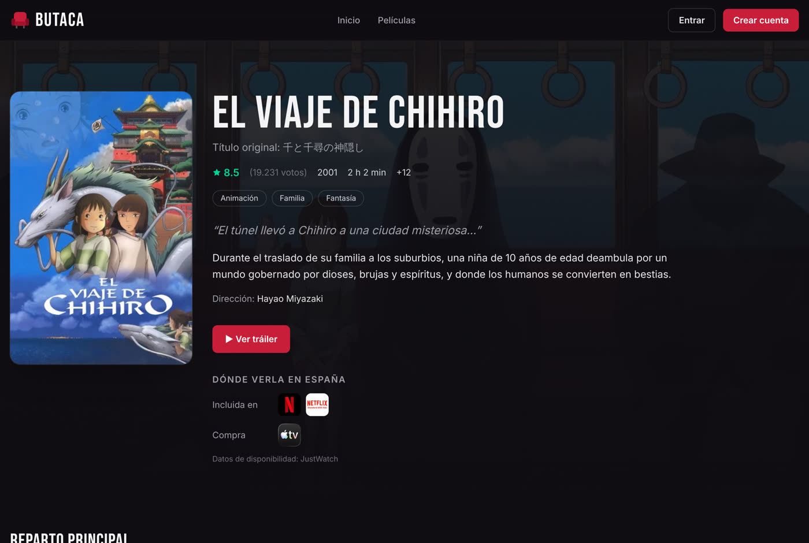 | 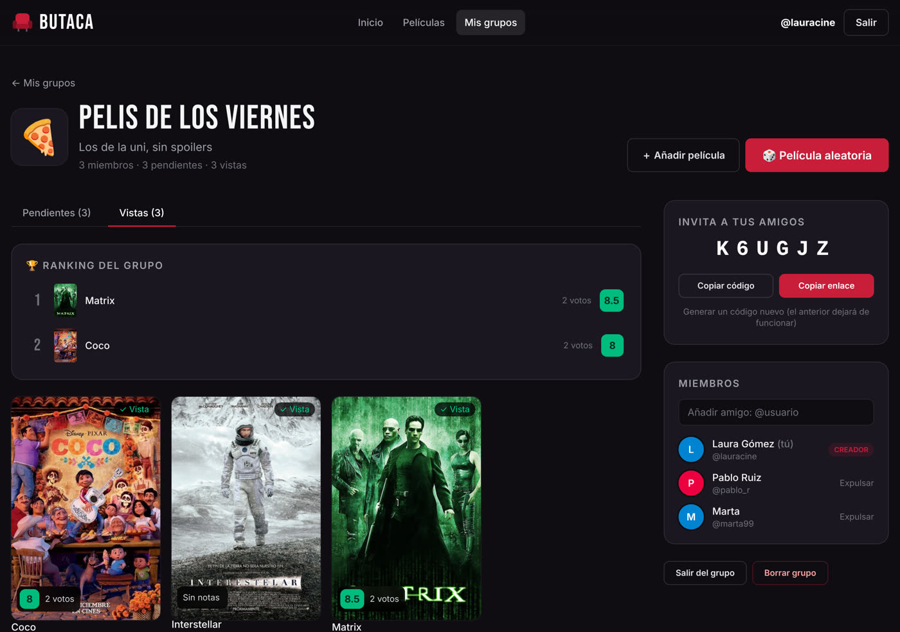 |
| **Ruleta de película aleatoria** | **Recomendaciones de Ratatús** |
| 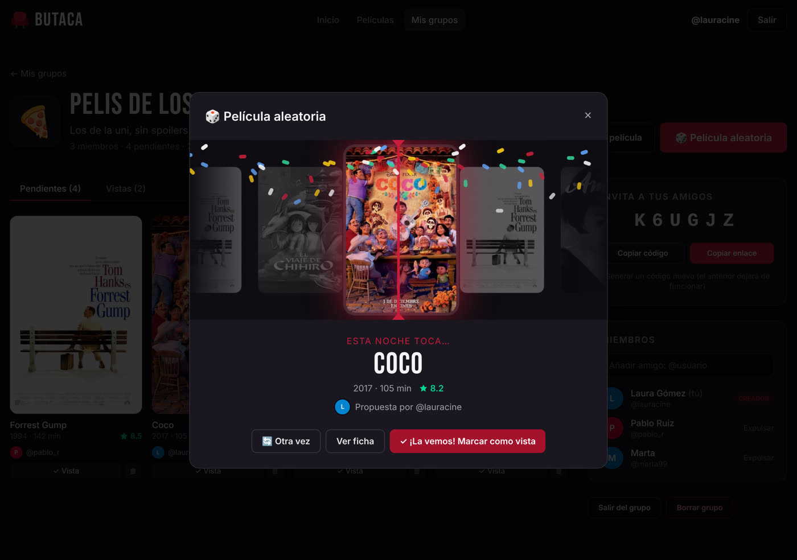 | 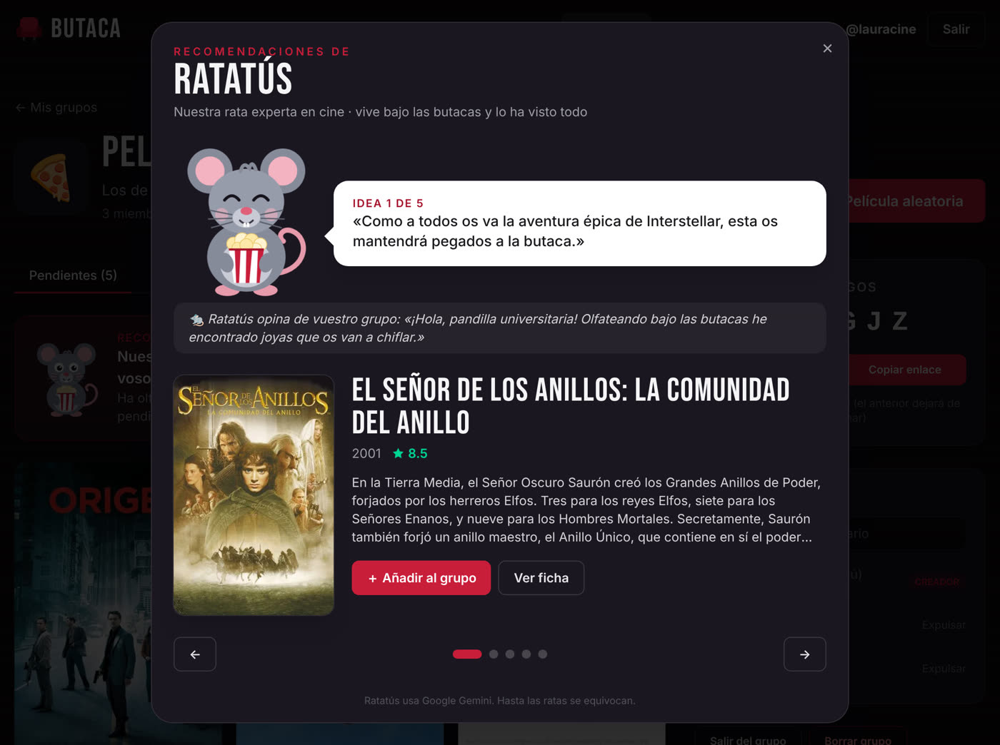 |
| **Sommelier filtrando por plataformas** | **Perfil con "Ratatús dice…"** |
| 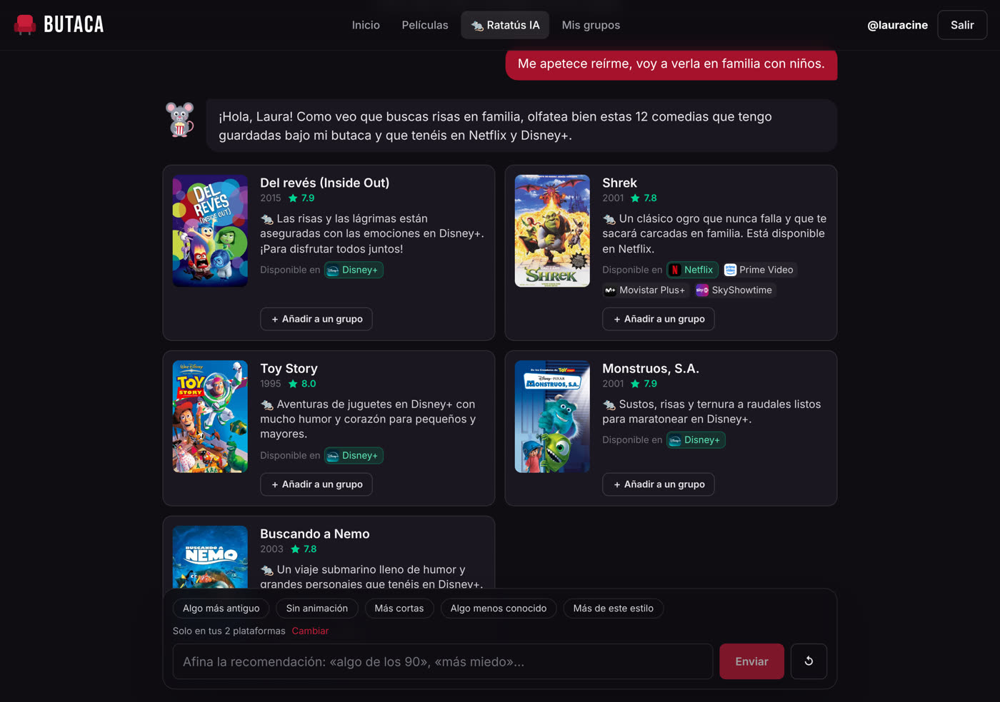 | 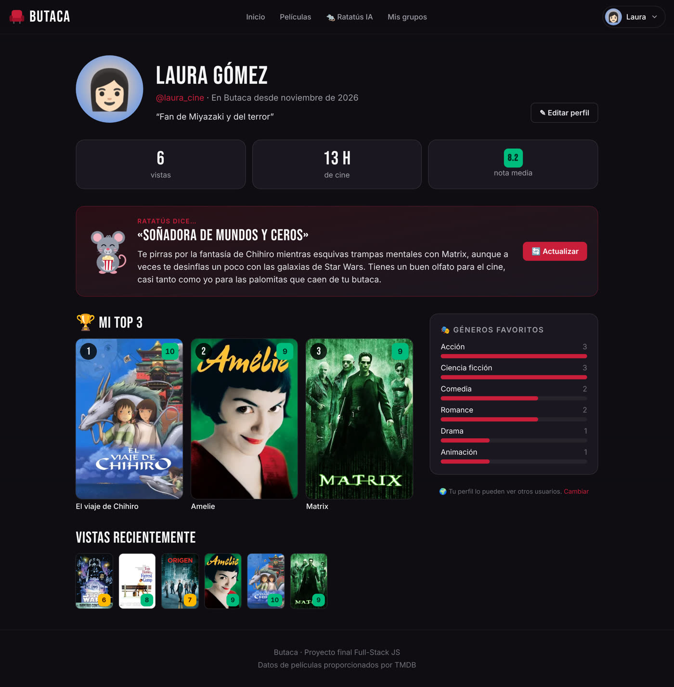 |
| **Back-Office: panel** | **Back-Office: editor de colecciones** |
| 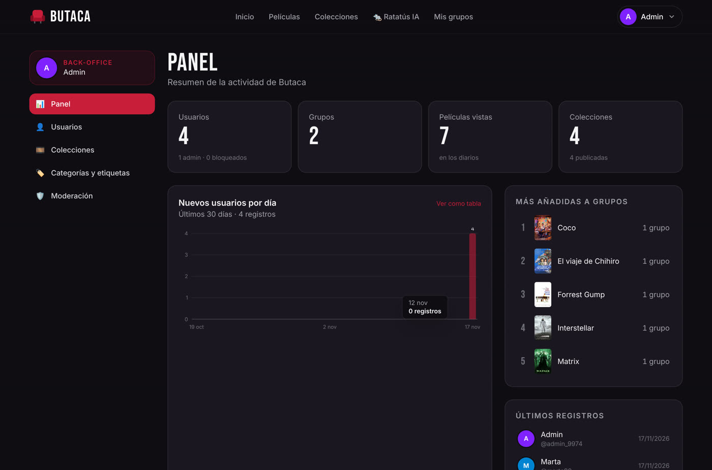 | 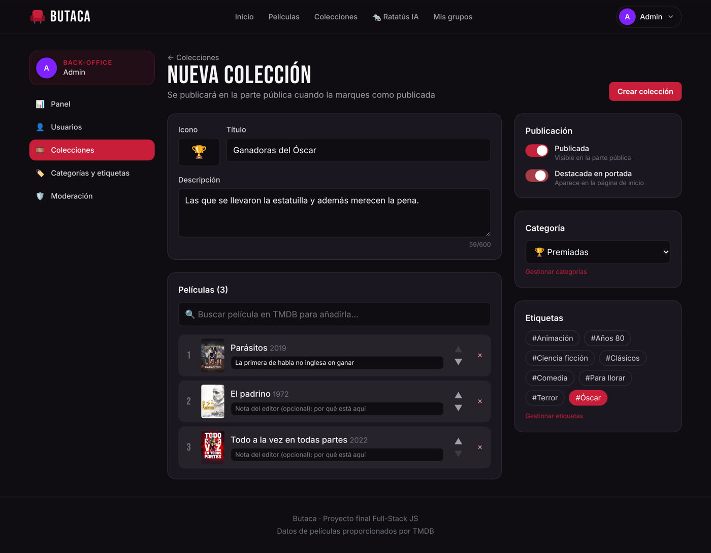 |
| **Colecciones en la portada** | **Versión móvil** |
| 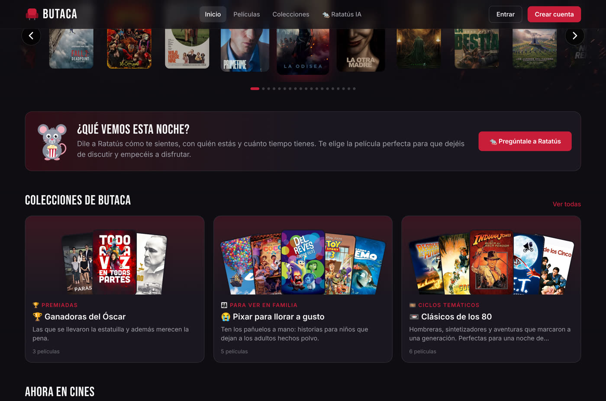 | 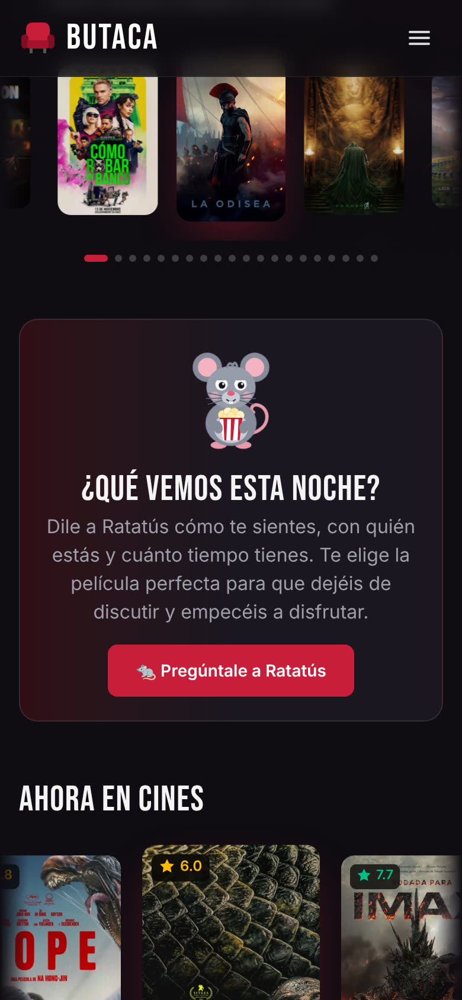 |

---

## 🧰 Tecnologías

| Capa | Tecnologías |
|---|---|
| **Frontend** | React 19, Vite 6, React Router 7, Tailwind CSS 4, Axios, Context API, Canvas API, SVG + animaciones CSS |
| **Backend** | Node.js 22, Express 5, Mongoose 8, JSON Web Token, bcryptjs, CORS, dotenv |
| **Base de datos** | MongoDB Atlas |
| **APIs externas** | [TMDB](https://www.themoviedb.org/) (catálogo, imágenes, tráileres y disponibilidad vía JustWatch), YouTube (tráileres) |
| **Inteligencia artificial** | Google Gemini (endpoint compatible con OpenAI, salida estructurada con JSON Schema) |
| **Despliegue** | Vercel (frontend), Render (backend), MongoDB Atlas (BD) |
| **Herramientas** | Git y GitHub, npm, ESLint, Playwright (pruebas en navegador), Docker (MongoDB local), VS Code |

---

## 🏗 Arquitectura

```
                ┌──────────────────────────────┐
  Navegador ───►│  Vercel · React (SPA)         │  https://butaca-roan.vercel.app
                └──────────────┬───────────────┘
                               │  HTTPS + JWT (Authorization: Bearer …)
                               ▼
                ┌──────────────────────────────┐
                │  Render · Express API         │  https://butaca-api.onrender.com
                └───┬───────────┬──────────┬───┘
                    │           │          │
                    ▼           ▼          ▼
             MongoDB Atlas    TMDB     Google Gemini
            (usuarios, grupos, (películas, (Ratatús: recomienda;
             diarios, fotos,   carteles,   TMDB verifica que las
             colecciones…)     plataformas) películas existen y
                                            dónde se pueden ver)
```

- Las **claves de TMDB y Gemini solo viven en el servidor**: el navegador nunca las ve.
- El servidor **cachea** las respuestas de TMDB 30 minutos.
- Las **fotos** (grupos y perfiles) se reducen en el navegador y se guardan en MongoDB, porque el disco de Render se borra en cada despliegue.

### Modelo de datos (colecciones de MongoDB)

| Colección | Contenido |
|---|---|
| `users` | Cuenta, rol (`user`/`admin`), bio, privacidad, plataformas, perfil cinéfilo |
| `groups` | Miembros, código de invitación y **películas embebidas** con sus **puntuaciones** embebidas |
| `watchedmovies` | Diario personal (índice único usuario + película) |
| `collections` | Colecciones del Back-Office con sus películas, categoría y etiquetas |
| `categories`, `tags` | Organización de las colecciones |
| `groupimages`, `useravatars` | Fotos (en colecciones aparte para no "engordar" las consultas) |

---

## 📁 Estructura del proyecto

```
butaca/
├── render.yaml              ← despliegue del backend en Render (Blueprint)
├── package.json             ← scripts para arrancar todo a la vez
├── docs/img/                ← capturas del README
├── client/                  ← FRONTEND (React + Vite + Tailwind)
│   ├── vercel.json          ← rutas de la SPA en Vercel
│   └── src/
│       ├── pages/           ← páginas públicas y de usuario
│       ├── admin/           ← Back-Office
│       ├── components/      ← componentes reutilizables (carruseles, Ratatús, ruleta…)
│       ├── context/         ← AuthContext (sesión)
│       ├── hooks/           ← useFetch, useReducedMotion
│       ├── services/        ← llamadas a la API
│       └── utils/           ← reducir imágenes en el navegador
└── server/                  ← BACKEND (Express + Mongoose)
    └── src/
        ├── index.js         ← punto de entrada
        ├── config/          ← conexión a MongoDB, plataformas de streaming
        ├── models/          ← esquemas de Mongoose
        ├── routes/          ← rutas de la API
        ├── controllers/     ← lógica de cada ruta
        ├── middleware/      ← autenticación, roles, límite de uso, errores
        ├── services/        ← TMDB, Gemini, estadísticas, borrado de usuarios
        ├── utils/           ← imágenes, slugs, errores HTTP
        └── scripts/         ← create-admin, seed, sincronización
```

---

## 💻 Instalación en local

### Requisitos
- **Node.js 20 o superior** y **npm**
- Una base de datos **MongoDB** (gratis en [MongoDB Atlas](https://www.mongodb.com/atlas) o local con Docker)
- Claves gratuitas de **[TMDB](https://www.themoviedb.org/settings/api)** y **[Google AI Studio (Gemini)](https://aistudio.google.com/apikey)**

### Pasos

```bash
# 1. Clonar el repositorio
git clone https://github.com/alejandrodavidmartino/butaca.git
cd butaca

# 2. Instalar dependencias (raíz, servidor y cliente)
npm install
npm run install:all

# 3. Crear el archivo de variables de entorno del servidor y rellenarlo
cp server/.env.example server/.env

# 4. (Opcional) MongoDB local con Docker, si no usas Atlas
docker run -d --name mongo -p 27017:27017 mongo:7

# 5. Crear un administrador y contenido de ejemplo
npm run create-admin --prefix server -- admin@butaca.com "Administrador" unaContraseñaSegura
npm run seed --prefix server

# 6. Arrancar frontend y backend a la vez
npm run dev
```

- Web: **http://localhost:5173** (Vite redirige `/api` al backend)
- API: **http://localhost:4000/api/health**

---

## 🔐 Variables de entorno

### `server/.env`

| Variable | Obligatoria | Descripción |
|---|---|---|
| `PORT` | No | Puerto de la API (por defecto `4000`; Render pone el suyo) |
| `CLIENT_URL` | Sí | URL(s) del frontend permitidas por CORS, separadas por comas. Ej.: `https://butaca-roan.vercel.app,http://localhost:5173` |
| `MONGODB_URI` | Sí | Cadena de conexión de MongoDB (Atlas o local) |
| `MONGODB_DB` | No | Nombre de la base de datos (por defecto `butaca`) |
| `JWT_SECRET` | Sí | Secreto largo y aleatorio para firmar los tokens. Generar con `node -e "console.log(require('crypto').randomBytes(32).toString('hex'))"` |
| `TMDB_READ_TOKEN` o `TMDB_API_KEY` | Sí | Credencial de TMDB: el *Read Access Token* (largo, `eyJ…`) o la *API Key* (32 caracteres). El servidor detecta cuál es |
| `GEMINI_API_KEY` | Sí | Clave de Google AI Studio |
| `GEMINI_MODEL` | No | Modelo principal (por defecto `gemini-3.5-flash-lite`; si falla, se prueban otros automáticamente) |

### `client/.env` (solo en producción)

| Variable | Descripción |
|---|---|
| `VITE_API_URL` | URL de la API terminada en `/api`. Ej.: `https://butaca-api.onrender.com/api`. En desarrollo no hace falta |

> ⚠️ Los archivos `.env` **nunca** se suben a GitHub (están en `.gitignore`). Solo se suben las plantillas `.env.example`.

---

## 📜 Scripts disponibles

| Dónde | Comando | Qué hace |
|---|---|---|
| Raíz | `npm run install:all` | Instala las dependencias de `server` y `client` |
| Raíz | `npm run dev` | Arranca frontend y backend a la vez |
| `server` | `npm run dev` / `npm start` | Backend en desarrollo (nodemon) / producción |
| `server` | `npm run create-admin -- email "Nombre" contraseña` | Crea un administrador (o asciende a admin a un usuario existente si solo se indica el email) |
| `server` | `npm run seed` | Crea categorías, etiquetas y colecciones de ejemplo (no duplica) |
| `server` | `npm run lint` | Revisión de código del backend (ESLint) |
| `client` | `npm run dev` / `npm run build` | Frontend en desarrollo / compilación para producción |
| `client` | `npm run lint` | Revisión de código del frontend (ESLint) |

---

## 🚀 Despliegue

La aplicación está desplegada en servicios gratuitos: **MongoDB Atlas** (base de datos), **Render** (backend) y **Vercel** (frontend).

### 1. Base de datos · MongoDB Atlas
1. Crear un cluster gratuito **M0** (región Europa).
2. *Database Access* → crear un usuario de base de datos con contraseña.
3. *Network Access* → permitir `0.0.0.0/0` (Render no tiene IP fija).
4. *Connect → Drivers* → copiar la cadena `mongodb+srv://…` (será `MONGODB_URI`).

### 2. Backend · Render
1. En [render.com](https://render.com) → **New → Blueprint** → elegir este repositorio. Render lee `render.yaml` (servicio web gratuito, carpeta `server`, `npm ci` y `npm start`, comprobación en `/api/health`) y **genera `JWT_SECRET`** automáticamente.
2. Rellenar las variables secretas: `MONGODB_URI`, `TMDB_API_KEY` (o `TMDB_READ_TOKEN`), `GEMINI_API_KEY` y `CLIENT_URL`.
3. Al terminar, comprobar `https://<servicio>.onrender.com/api/health` y `.../api/health/tmdb`.

### 3. Frontend · Vercel
1. En [vercel.com](https://vercel.com) → **Add New → Project** → importar este repositorio.
2. **Root Directory: `client`** (framework Vite detectado automáticamente).
3. Variable de entorno `VITE_API_URL = https://<servicio>.onrender.com/api` y **Deploy**. (`vercel.json` hace que las rutas de React funcionen al recargar).

### 4. Conectar ambos
En Render, poner en `CLIENT_URL` la URL de Vercel (sin barra final), por ejemplo `https://butaca-roan.vercel.app`, y guardar.

### 5. Datos iniciales
Desde local (apuntando al mismo `MONGODB_URI` de Atlas):
```bash
npm run create-admin --prefix server -- admin@ejemplo.com "Administrador" contraseña
npm run seed --prefix server
```

Cada `git push` a `main` **redespliega automáticamente** frontend y backend.

---

## 🔌 API REST

Todas las rutas empiezan por `/api`. 🔒 = requiere sesión · 🛠 = requiere rol de administrador.

| Recurso | Rutas principales |
|---|---|
| **Estado** | `GET /health` · `GET /health/tmdb` |
| **Auth** | `POST /auth/register` · `POST /auth/login` · 🔒 `GET/PATCH/DELETE /auth/me` · 🔒 `PATCH /auth/me/password` · 🔒 `PUT/DELETE /auth/me/avatar` |
| **Películas** (TMDB) | `GET /movies/list/:lista` · `GET /movies/search` · `GET /movies/discover` · `GET /movies/genres` · `GET /movies/platforms` · `GET /movies/random` · `GET /movies/:id` |
| **Grupos** 🔒 | `GET/POST /groups` · `POST /groups/join` · `GET/PATCH/DELETE /groups/:id` · miembros, películas, puntuaciones (`PUT /groups/:id/movies/:tmdbId/rating`), ruleta (`GET /groups/:id/random`) y foto |
| **Mis vistas** 🔒 | `GET /me/watched` · `GET /me/watched/stats` · `GET/PUT/DELETE /me/watched/:tmdbId` |
| **Usuarios** | 🔒 `GET /users/search` · 🔒 `GET /users/:username/profile` · `GET /users/:id/avatar` · 🔒 `POST /users/me/taste` |
| **IA** 🔒 | `POST /ai/sommelier` · `POST /ai/groups/:id/recommend` |
| **Colecciones** (públicas) | `GET /collections` · `GET /collections/categories` · `GET /collections/:slug` |
| **Back-Office** 🛠 | `GET /admin/stats` · usuarios, categorías, etiquetas, colecciones, grupos y comentarios (`/admin/...`) |

---

## 🐀 Inteligencia artificial: Ratatús

Ratatús es la mascota de Butaca: una rata que vive bajo las butacas del cine y lo ha visto todo. Está dibujada en **SVG** y animada con **CSS**, y "habla" gracias a **Google Gemini**:

- **Sommelier de cine**: conversación en la que eliges ánimo, compañía y tiempo disponible, y puedes afinar ("algo más antiguo", "sin animación").
- **Recomendaciones para el grupo**: analiza las notas y comentarios de cada miembro.
- **Perfil cinéfilo**: resume con humor los gustos de cada usuario a partir de su diario.

Técnicas aplicadas:
- *System prompt* con personalidad y reglas (películas reales, español de España, sin spoilers, ignorar intentos de cambiar las reglas).
- **Salida estructurada** (JSON Schema) para procesar las respuestas sin errores.
- **Contexto con datos reales**: notas del grupo, diario del usuario (no recomienda lo ya visto) y plataformas.
- **La IA propone, TMDB verifica**: cada título se busca en TMDB (cartel e id reales) y se comprueba en qué plataformas está en España. Si faltan películas disponibles, Ratatús elige del **catálogo real** de tus plataformas.
- **Respaldo automático** entre modelos si uno está saturado y **límite de uso** por usuario.

---

## 🛡 Seguridad, privacidad y accesibilidad

- Contraseñas cifradas con **bcrypt**; autenticación **JWT**; roles `user` / `admin` comprobados **en el servidor**.
- Usuarios bloqueados no pueden iniciar sesión ni usar la API; un admin no puede bloquearse ni borrarse a sí mismo.
- **CORS** con lista blanca de orígenes; claves de APIs solo en el servidor.
- Validación de datos con Mongoose; las imágenes se validan por su **firma real** (JPEG/PNG/WEBP) y tamaño.
- Filtro de **spam** en las sinopsis de TMDB.
- **RGPD**: perfil privado opcional, comentarios del diario privados y **derecho al olvido** (borrar la cuenta elimina sus datos).
- **Accesibilidad**: etiquetas `aria-*`, navegación por teclado (carruseles, menús, modales con Escape), textos alternativos, tablas alternativas a los gráficos y respeto de **"reducir movimiento"**.
- **Diseño responsive** probado en móvil y escritorio.

---

## 🙏 Créditos

- Datos e imágenes de películas: **[TMDB](https://www.themoviedb.org/)**. *Este producto usa la API de TMDB pero no está avalado ni certificado por TMDB.*
- Disponibilidad en plataformas: **JustWatch** (a través de TMDB).
- Inteligencia artificial: **Google Gemini**.
- Mascota Ratatús, logo e interfaz: diseño propio.

**Autor:** [@alejandrodavidmartino](https://github.com/alejandrodavidmartino) · Proyecto del Módulo Full-Stack JS.
